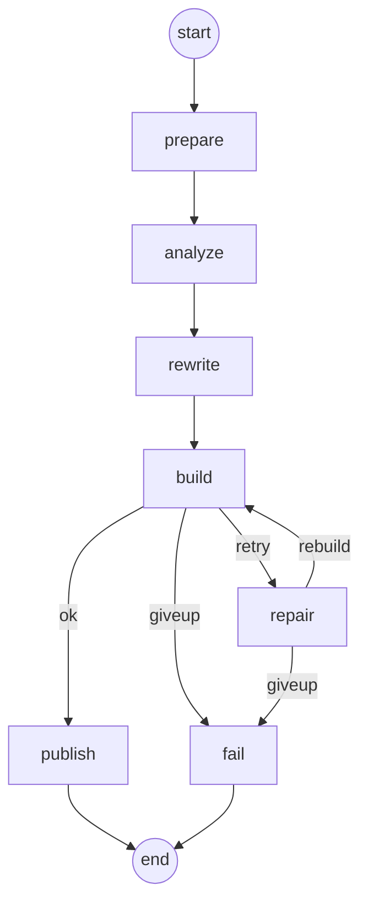

# Java Migration Agent (17 → 25)

A Spring Boot service that migrates a fleet of Java 17 microservices to Java 25 using one AI agent per service,
all running in parallel. A real-time dashboard shows every service as it moves through the pipeline.

Each agent does the safe, mechanical work with **OpenRewrite**, proves the result with a **real build and test run
on JDK 25**, and only calls the **LLM** to repair what is still broken. Finished services get a branch and a pull
request. Nothing is ever merged automatically.

## How it works



| Node | What it does |
|---|---|
| prepare | clones the repo, creates the `migrate/java-25` branch |
| analyze | detects Maven/Gradle, current Java, Spring Boot version, Lombok; records warnings |
| rewrite | OpenRewrite `UpgradeToJava25` recipe (deterministic, no LLM) |
| build | `mvn clean verify` / `gradle build` on **JDK 25**, with a hard timeout |
| repair | LLM gets the build log tail and the files the log points at, returns search/replace edits; edits are validated and applied; the build runs again |
| publish | commit, push, open a PR with a summary of what the LLM touched |
| fail | records why, so a human can pick it up |

The repair loop stops early when the model says it needs a human (`NO_CHANGES_POSSIBLE`), when two rounds in a row
produce no applicable edits, or after `max-repair-attempts`.

**Fleet level:** `services.yml` declares dependencies (BOM, parent POM, shared libraries). Services are grouped
into waves; everything inside a wave runs in parallel on virtual threads, capped by `max-parallel`. If a shared
library fails, the services that depend on it are **skipped**, not built against a broken parent.

## Try it in 30 seconds (simulation, no setup)

```bash
mvn spring-boot:run
# open http://localhost:8080  ->  Start migration
```

`SIMULATE` is the default mode. It runs the real graph, prompt building, patch applier and orchestrator against a
fake toolbox with 30 demo services: most migrate cleanly, about a quarter need an LLM repair round, one needs a
human (`legacy-billing-engine`), and its dependent (`reporting-service`) is skipped. Use it to see the dashboard
and the failure handling before pointing the agent at real code.

## Run it for real

Prerequisites on the machine (or container) that runs the agent: **JDK 25**, `git`, Maven (or your Gradle wrappers),
and optionally the GitHub CLI `gh` for pull requests.

```bash
cp services.example.yml services.yml          # list your 30 services + dependsOn
export MIGRATION_MODE=REAL
export JDK25_HOME=/path/to/jdk-25             # every service is built and tested with this JDK
export ANTHROPIC_API_KEY=...                  # the repair LLM
export GH_TOKEN=...                           # push + PRs (or rely on your SSH agent / credential helper)
export MIGRATION_API_TOKEN=$(openssl rand -hex 24)
mvn spring-boot:run
# dashboard: http://localhost:8080/?token=<your MIGRATION_API_TOKEN>
```

The agent refuses to start in `REAL` mode unless `JDK25_HOME` really is a JDK 25. Do a first run on 2 or 3 services
(`POST /api/migrations {"services":["common-lib","orders-service"]}`) and review those PRs before the full fleet.

## Can it really finish in 5 to 10 minutes?

Only with enough hardware and a warm cache, and only for services that are mostly mechanical. Wall time is roughly
`rounds × (clone + rewrite + build [+ repair × (LLM + rebuild)])`, where `rounds = ceil(services / max-parallel)`
per dependency wave.

| Fleet | Setup | Rough wall time |
|---|---|---|
| 30 services, all independent, no repairs | `max-parallel: 30`, 32 cores / 48 GB, warm `~/.m2` or a Nexus mirror | 4 to 7 min |
| 30 services, ~1/4 need one repair | same machine | 7 to 12 min |
| same fleet on a 4-core laptop, `max-parallel: 4` | cold cache | 30+ min |

Each running build is a Maven/Gradle JVM of about 1 to 1.5 GB, so `max-parallel` is bounded by RAM and cores, not
by this app. Levers that matter most: a warm shared Maven cache, `skip-tests: true` for the first pass (run the
full suite in CI on the PRs), and a shared-library wave that is small and fast. These numbers are estimates from
typical Maven build times, not measurements of your services.

## Configuration (application.yml)

| Property | Default | Meaning |
|---|---|---|
| `migration.mode` | `SIMULATE` | `REAL` to clone, build, call the LLM, push |
| `migration.jdk-home` | `$JDK25_HOME` | JDK 25 used for every build |
| `migration.max-parallel` | 15 | simultaneous service agents |
| `migration.max-repair-attempts` | 3 | LLM repair rounds per service |
| `migration.build-timeout-minutes` | 8 | kills a hung build |
| `migration.skip-tests` | false | compile-only fast pass |
| `migration.rewrite-recipe` | `org.openrewrite.java.migrate.UpgradeToJava25` | deterministic pass |
| `migration.push` / `open-pull-request` | true / true | set both false for local-only commits |
| `migration.llm.model` | `claude-sonnet-5-5` | repair model |
| `migration.llm.concurrency` | 8 | simultaneous LLM calls across all agents |
| `migration.api-token` | empty | required on `/api` when set |

## API

| Method | Path | |
|---|---|---|
| GET | `/api/services` | configured services and their dependency waves |
| POST | `/api/migrations` | start a run, optional body `{"services":["a","b"]}`; 409 if one is active |
| GET | `/api/migrations` / `/{id}` | run snapshot(s) |
| GET | `/api/migrations/{id}/events` | live **SSE** stream (full history replayed first) |
| GET | `/api/migrations/{id}/report` | markdown report (also written to `work/<id>/report.md`) |
| DELETE | `/api/migrations/{id}` | stop scheduling new services |

## Safety model

- Work happens on a `migrate/java-25` branch in a fresh clone; **no auto-merge**, every change goes through a PR.
- The PR body lists the files the LLM edited so reviewers know where to look first.
- LLM edits are search/replace blocks, validated before applying: the search text must match exactly once, paths
  cannot leave the project, and `.git`, `.env`, keys and keystores are protected. Rejections are fed back to the model.
- The playbook forbids deleting or weakening tests and inventing dependency versions; unsure means "needs a human".
- Service names, repo URLs, branches and sub-directories are validated (no path traversal or git option injection).
- `/api` is token-protected and the server binds to loopback unless you change `BIND_ADDRESS`.
- Builds and git calls have timeouts, stdin is closed, output is capped.

## What was verified, and what was not

Verified by compiling and running (JDK 21, 30 automated tests): the graph engine, dependency waves, patch applier
(including path-traversal and CRLF cases), project scanner, repair-prompt builder, the parallel orchestrator with
30 simulated services (repair loop, early give-up, dependent skipping, ordering, cancel, single-active-run), the
process runner (timeouts, output truncation) and real git clone/branch/commit/push against a local repository.

**Not verified** (the build sandbox had no access to Maven Central or GitHub): the Spring Boot layer
(`MigrationConfig`, `MigrationController`, `ApiTokenFilter`, SSE streaming), `AnthropicLlmClient`, the dashboard in a
browser, the Dockerfile, and a real OpenRewrite/Maven/Gradle run against real services. The dependency versions in
`pom.xml` (Spring Boot 3.5.6) should be bumped to your current release. The OpenRewrite
[Java 25 guide](https://docs.openrewrite.org/running-recipes/popular-recipe-guides/migrate-to-java-25) says the recipe
artifacts are served from a separate repository that needs credentials in `settings.xml`; check it for your setup.
Run `mvn test` first, then a small simulated run, then 2 or 3 real services.

## Layout

```
graph/         StateGraph (LangGraph-style engine, no dependencies)
agent/         per-service graph, patch applier, repair prompts, playbook, scanner
orchestrator/  waves, parallel runner, live events, run registry
infra/         git/gh, Maven/Gradle build, OpenRewrite, Anthropic client, process runner
sim/           simulated toolbox for demos and tests
api/ config/   Spring REST + SSE, token filter, wiring
```

## Next steps worth building

- **Baseline build on 17** before touching anything, so failures that already existed are not blamed on the migration.
- **LangGraph4j** instead of the built-in `StateGraph` if you want its checkpointing and human-in-the-loop; the node
  functions in `MigrationGraphFactory` carry over unchanged.
- Persist runs (database) so a restart does not lose history, and a webhook to post results to Slack.
- A second recipe pass for your organisation's own conventions (logging, internal starters).
